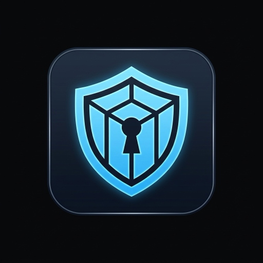

<div align="center">



# DockVault

**Self-hosted Docker Volume & Compose Backup Vault**

Automatically discover running containers, Compose stacks, and named volumes—back them up safely with optional AES-256-GCM encryption, store or replicate across Local, S3, Azure Blob, SSH/SFTP, SMB, and NFS destinations, verify integrity, and track restores with one click.

<p>
  <a href="https://github.com/muecahit94/dockvault/actions/workflows/release-please-docker-build.yml">
    
  </a>
  <a href="https://github.com/muecahit94/dockvault/releases/latest">
    
  </a>
  <a href="https://hub.docker.com/r/muecahit/dockvault">
    
  </a>
  <a href="https://hub.docker.com/r/muecahit/dockvault">
    
  </a>
  <a href="https://github.com/muecahit94/dockvault/pkgs/container/dockvault">
    
  </a>
  <a href="https://github.com/muecahit94/dockvault/stargazers">
    
  </a>
  <a href="https://github.com/muecahit94/dockvault/blob/main/LICENSE">
    
  </a>
</p>

</div>

---

## What is DockVault?

I originally built DockVault for my own homelab because maintaining custom cron + `tar` backup scripts for every self-hosted Docker Compose stack quickly gets tedious and fragile. It is designed to be an easy-to-set-up, drop-in backup solution for any Docker or Docker Compose homelab: deploy a single lightweight container with `/var/run/docker.sock` mounted, run `docker compose up -d`, and manage everything from a clean web UI.

Instead of configuring every service manually, DockVault inspects your Docker Engine, groups containers into Compose stacks, finds every attached volume and bind mount (plus unattached orphan volumes), and handles consistent `.tar.gz` / `.tar.zst` archiving, encryption, scheduling, retention pruning, alerting, and one-click recovery.

---

## Features

### Discovery & Safe Archiving
- **Automatic Docker & Compose Discovery** — Detects running and stopped containers, groups Compose stacks (`com.docker.compose.project`), surfaces unattached **orphan volumes**, and displays configured schedules and active rollback versions directly on stacks and containers.
- **Zero-Downtime DB Hot Dumps** — Auto-detects `postgres`, `mysql`, `mariadb`, `mongodb`, and `redis` and appends consistent dumps into `db_dumps/` inside the archive without pausing DB containers.
- **Pause-Consistent Snapshots & Exclude Patterns** — Temporarily pauses target container(s) while a lightweight helper container (`alpine:3.21`) streams volume contents into `.tar.gz` or `.tar.zst`, skipping `.gitignore`-style exclude globs, then unpauses immediately.
- **Pre/Post Exec Hooks & Selective Mounts** — Run custom commands inside containers before and after archiving via modal overrides or labels, and pick specific volumes or bind mounts per backup.

### Storage Destinations & 3-2-1 Replication
- **Local Disk** — Store archives directly on host volumes or mounted paths (`/app/backups`).
- **S3-Compatible Object Storage** — Connect AWS S3, MinIO, Cloudflare R2, Backblaze B2, Wasabi, and other S3 APIs with custom endpoints, path prefixing, and SSL control.
- **Azure Blob Storage** — Supports **Account Key**, **Service Principal (Entra ID App Registration)**, **Connection String**, and **SAS Token** authentication, selectable access tiers (`Hot`, `Cool`, `Cold`, `Archive`), automatic container creation, and 1-hour pre-signed SAS download URLs.
- **SSH / SFTP** — Transfer archives to any SSH/NAS target (or Hetzner Storage Box) using a password, pasted PEM/OpenSSH private key, or a **local container SSH key** mounted into `/root/.ssh` (auto-discovered or explicit path, optional passphrase).
- **SMB / CIFS & NFS (User-Space)** — Connect directly to Samba/TrueNAS/Synology **SMB** shares or **NFSv3** exports (`AUTH_UNIX` UID/GID configurable) in pure Go without host mounts, root privileges, or `CAP_SYS_ADMIN`.
- **3-2-1 Offsite Replication & Scan Import** — Automatically replicate any manual or scheduled backup to a secondary offsite destination, and use **Scan & Import** across any destination when rebuilding a host.

### Encryption, Inspection & Restore Tracking
- **Client-Side Encryption (AES-256-GCM)** — Enable encryption per storage destination to encrypt archives locally into `.tar.gz.enc` / `.tar.zst.enc` (scrypt key derivation + chunked AES-256-GCM) before upload; transparently decrypted on **Inspect**, **Download**, **Verify**, and **Restore** (raw `.enc` downloads remain available via `?raw=true`).
- **Archive Tree Inspector & Single-File Extract** — Browse files inside backups directly in the browser and extract a single config or database file without downloading the whole archive.
- **SHA-256 Integrity Verification & Compare** — Every backup records a SHA-256 digest for on-demand verification, and any two snapshots in History can be diffed for added, removed, and changed files.
- **Safer One-Click & Selective Restore** — Restore entire mounts in place or into an isolated **Staging Volume**, optionally taking an automatic **Pre-Restore Safety Snapshot** before overwriting data, or restore only ticked paths.
- **Restore & Rollback Visibility** — Every restore is persisted in **History → Restore Log**, with **Current version / Rolled back** badges across Dashboard, History, and Containers & Volumes so you always know which backup snapshot a target rolled back to.
- **Notes & Bulk History Actions** — Annotate backups (e.g. "before postgres 17 upgrade") and multi-select backups to pin, unpin, verify, compare, or delete them in bulk.

### Scheduling, Retention & Multi-Channel Alerts
- **Multi-Target Cron Scheduler** — Activate multiple Compose stacks, containers, and/or volumes in a single cron schedule (or create individual schedules) with live **Next Run** previews, timezone support (`TZ`), 24-hour collision timeline, and one-click **Run Now**.
- **Keep-N & GFS Retention + Pinning** — Automatically prune old snapshots by count (`Keep Latest N`) or **Grandfather-Father-Son (Daily / Weekly / Monthly)** rules, and **Pin** critical backups so they are never pruned.
- **Reusable Policies & GitOps Labels** — Duplicate schedules, apply policies across targets, or declare schedules and hooks via Docker labels.
- **Overdue Backup Alerts** — Set a per-schedule alert window (e.g. 26h for a daily job) to get notified when backups silently stop succeeding, not just when they fail.
- **Resilient Transfers** — S3 and Azure uploads/downloads automatically retry transient failures with backoff, and live backup progress streams over SSE.
- **Multiple Notification Channels** — Configure and independently enable/disable multiple **Telegram Bot** (with optional topic/thread IDs), **Discord**, **Slack**, **ntfy**, or **Generic JSON Webhook** channels, with per-channel failure/success triggers, one-click test alerts, and optional browser desktop notifications.

### Security & Customizable Workspace
- **Built-in Auth & Reverse Proxy SSO** — Protect the UI with local username/password authentication (`bcrypt` + signed `HttpOnly` cookies) or delegate auth to a reverse proxy header (e.g., `Remote-User` from Authelia, Authentik, or Traefik ForwardAuth). Failed logins are rate-limited (10 per 15 minutes per client IP and username; set `DOCKVAULT_TRUSTED_PROXIES` behind a reverse proxy).
- **Configurable UI & Preferences** — Switch between Dark / Light / System themes, 5 accent colors, Comfortable / Compact table density, 12h / 24h clock format, instance badge name (e.g., `prod-eu`), default landing tab, and background auto-refresh intervals.

---

## Quick Start

### Docker Compose (Recommended)

Create a `docker-compose.yaml` file and start DockVault:

```yaml
services:
  dockvault:
    image: muecahit/dockvault:latest # or ghcr.io/muecahit94/dockvault:latest
    container_name: dockvault
    restart: unless-stopped
    ports:
      - "8080:8080"
    environment:
      - TZ=Europe/Berlin
      # Optional: bootstrap built-in admin login (or configure in Settings -> Security & Auth)
      # - DOCKVAULT_AUTH_USERNAME=admin
      # - DOCKVAULT_AUTH_PASSWORD=change-me-please
      # Optional: fallback passphrase for AES-256-GCM archive encryption
      # - DOCKVAULT_ENCRYPTION_KEY=your-strong-passphrase
    volumes:
      - /var/run/docker.sock:/var/run/docker.sock # Discover containers & stream volumes
      - ./data:/app/data                          # SQLite database & settings
      - ./backups:/app/backups                    # Local backup destination
      # Optional: mount host SSH keys to use container-local key auth for SSH/SFTP destinations
      # - ~/.ssh:/root/.ssh:ro
```

Start the container and open **`http://localhost:8080`**:

```bash
docker compose up -d
```

---

## User Guide

1. **Add Storage Destinations (`Settings → Storage`)**
   - A **Local Storage** destination (`/app/backups`) is ready out of the box.
   - Click **Add Storage Provider** to add **S3/MinIO**, **Azure Blob Storage**, **SSH/SFTP** (password, pasted key, or mounted container SSH key), **SMB/CIFS**, or **NFSv3**, test connectivity, and optionally enable **Client-Side Encryption (AES-256-GCM)**.
2. **Run a Manual Backup (`Containers & Volumes`)**
   - Switch between **Compose Stacks**, **Containers**, and **Volumes** (including configured schedules and active rollback badges right on each target).
   - Click **Run Backup** on any stack, container, or volume to choose mounts, `gzip`/`zstd`, primary + 3-2-1 secondary storage, pause behavior, DB hot dumps, and pre/post hooks.
3. **Automate with Schedules (`Schedules`)**
   - Create cron jobs covering one or multiple activated stacks, containers, and volumes with Keep-N or GFS retention rules and inspect the **Next Run** preview right in the modal.
   - Set **Alert if no successful backup within (hours)** to be warned about overdue schedules, and use **Duplicate** / **Apply to other targets** to reuse a policy.
4. **Set Up Alerts (`Settings → Notifications`)**
   - Click **Add Channel** to configure one or more channels (Telegram Bot, Discord, Slack, ntfy, or webhook), toggle each channel active/paused independently, and send a **Test** alert.
5. **Inspect, Verify & Restore (`History`)**
   - **Pin** important snapshots to protect them from retention pruning, add **notes**, or select several rows for bulk pin/verify/delete — select exactly two to **Compare** them.
   - Click the eye icon (**Inspect**) to browse archive entries, extract individual files, or run **Verify SHA-256**, and click **Download** to save the archive (decrypted on the fly if encrypted).
   - Click **Restore** to write an archive back to its target mounts (or a staging volume, with an optional pre-restore safety snapshot), and inspect the **Restore Log** tab and **Current version / Rolled back** indicators across Dashboard, History, and Containers.

---

### Container Labels (GitOps Auto-Schedules, Exclusions & Hooks)

Add optional Docker labels to your containers in `docker-compose.yaml` to declare backup policies and hooks declaratively:

```yaml
services:
  postgres:
    image: postgres:16-alpine
    volumes:
      - pgdata:/var/lib/postgresql/data
    labels:
      - dockvault.schedule=0 3 * * *
      - dockvault.compression=zstd
      - dockvault.db-dump=true
      - dockvault.retention=14
      - dockvault.exclude-paths=*.tmp,pg_wal/**

  cache:
    image: redis:7-alpine
    labels:
      - dockvault.exclude=true # Hide ephemeral cache containers from DockVault
```

| Label | Description |
|-------|-------------|
| `dockvault.schedule` | Cron expression used by **Sync GitOps Labels** / startup sync to auto-create and update managed schedules |
| `dockvault.exclude-paths` | Comma- or semicolon-separated `tar --exclude` glob patterns (e.g. `**/cache/**,*.log`) |
| `dockvault.compression` | Preferred archive compression (`gzip` or `zstd`) |
| `dockvault.retention` | Keep count for GitOps-managed schedules (default `7`) |
| `dockvault.db-dump` | Set `true` / `false` to enable or disable zero-downtime DB hot dumps (`postgres`, `mysql`, `mariadb`, `mongodb`, `redis`) |
| `dockvault.pre-backup` | Shell command executed inside the container (`sh -c ...`) before pausing and archiving |
| `dockvault.post-backup` | Shell command executed inside the container after unpausing (runs even if archiving fails) |
| `dockvault.exclude=true` | Excludes a container from DockVault discovery (`dockvault.enable=false` is also supported) |

---

## Configuration (Environment Variables)

| Variable | Description | Default |
|----------|-------------|---------|
| `DOCKVAULT_PORT` | HTTP server listen port (`PORT` also supported) | `8080` |
| `DOCKVAULT_DATA_DIR` | Directory storing the SQLite database (`dockvault.db`) | `./data` (`/app/data` in Docker) |
| `DOCKVAULT_BACKUP_DIR` | Default local backup archive directory | `./backups` (`/app/backups` in Docker) |
| `DOCKVAULT_HELPER_IMAGE` | Lightweight container image used to read/extract volumes | `alpine:3.21` |
| `DOCKVAULT_AUTH_USERNAME` | Optional bootstrap admin username for built-in login | _(unset)_ |
| `DOCKVAULT_AUTH_PASSWORD` | Optional bootstrap admin password (min 6 chars; enables auth) | _(unset)_ |
| `DOCKVAULT_TRUSTED_PROXY_HEADER` | Optional reverse-proxy SSO header (e.g., `Remote-User`, `X-authentik-username`) | _(unset)_ |
| `DOCKVAULT_ENCRYPTION_KEY` | Optional fallback passphrase for AES-256-GCM archive encryption | _(unset)_ |
| `DOCKVAULT_FRAME_ANCESTORS` | Optional origins allowed to iframe-embed the UI (replaces `X-Frame-Options: DENY`) | _(unset)_ |
| `DOCKVAULT_TRUSTED_PROXIES` | Optional reverse-proxy IPs/CIDRs (e.g. `172.16.0.0/12`) whose `X-Forwarded-For` is used to identify clients for login rate limiting | _(unset)_ |
| `TZ` | Timezone used for cron schedule evaluation and logs | `UTC` |

---

## Security Notes

- Access to `/var/run/docker.sock` grants control over the host Docker daemon. If DockVault is reachable beyond localhost, enable **Built-in Authentication** (under **Settings → Security & Auth** or via env vars) or place it behind an authenticated reverse proxy (Authelia, Authentik, Traefik ForwardAuth, or Tailscale) using `DOCKVAULT_TRUSTED_PROXY_HEADER`.
- `/var/run/docker.sock` bind mounts are automatically excluded from all backup archives.
- Storage secrets (S3 secret keys, Azure credentials, SSH passwords/private keys, SMB passwords, and encryption passphrases) and Telegram bot tokens are stored in SQLite and never returned by API read endpoints.

---

## Local Development

Run the Go backend (`:8080`) and Vite React dev server (`:5173`, proxying `/api` to `:8080`):

```bash
# Terminal 1 — Backend
cd backend
go run .

# Terminal 2 — Frontend
cd frontend
npm install
npm run dev
```

<details>
<summary>Tech Stack</summary>

| Layer | Technology |
|-------|------------|
| Backend | Go + Fiber (`v2`), pure-Go SQLite (`glebarez/sqlite` + GORM) |
| Docker Engine | Official Docker Go SDK (`github.com/docker/docker/client`) |
| Scheduler | `github.com/robfig/cron/v3` |
| Encryption | Chunked AES-256-GCM + `scrypt` (`golang.org/x/crypto/scrypt`) |
| Cloud & Network Storage | `minio-go/v7` (S3), `azblob` + `azidentity` (Azure Blob & Entra ID), `pkg/sftp` (SSH/SFTP), `go-smb2` (SMB/CIFS), `go-nfs-client` (NFSv3) |
| Frontend | React, Vite, Tailwind CSS (`v4`), Lucide Icons |
| Packaging & CI | Multi-stage Alpine container (`linux/amd64` & `linux/arm64`), GitHub Actions, Release Please, Renovate |

</details>

## License

[MIT](https://github.com/muecahit94/dockvault/blob/main/LICENSE)
